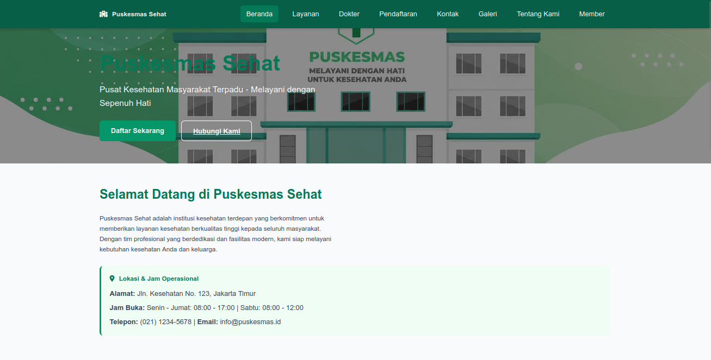
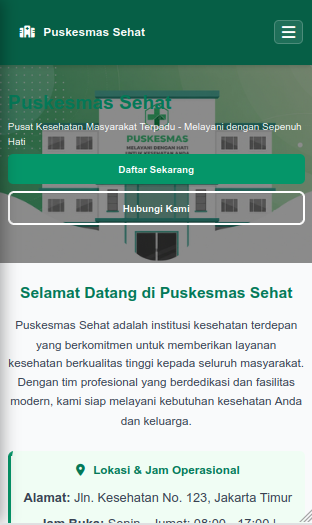
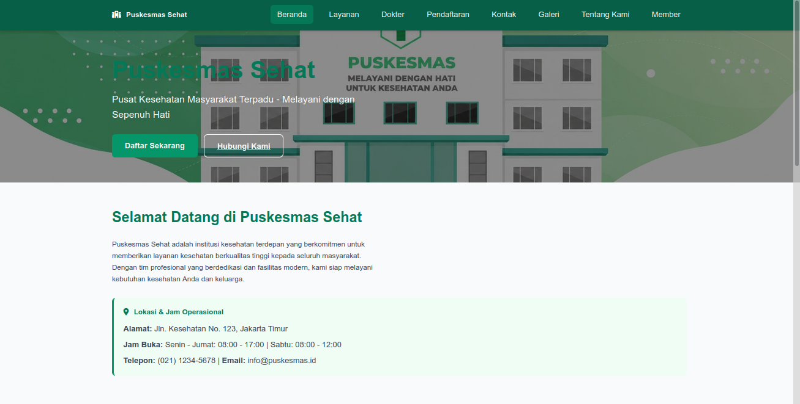
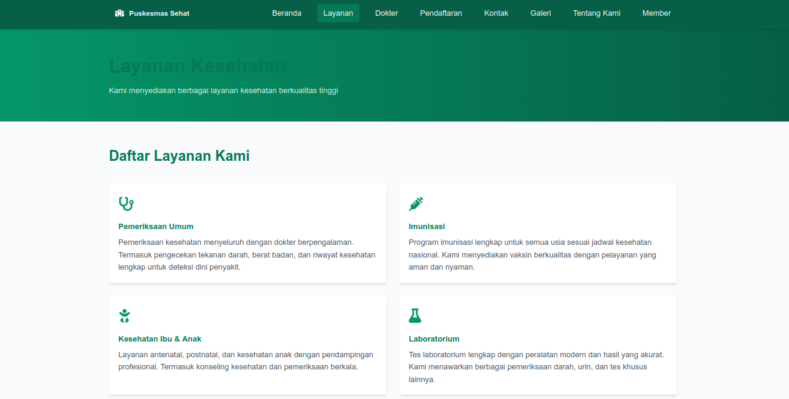
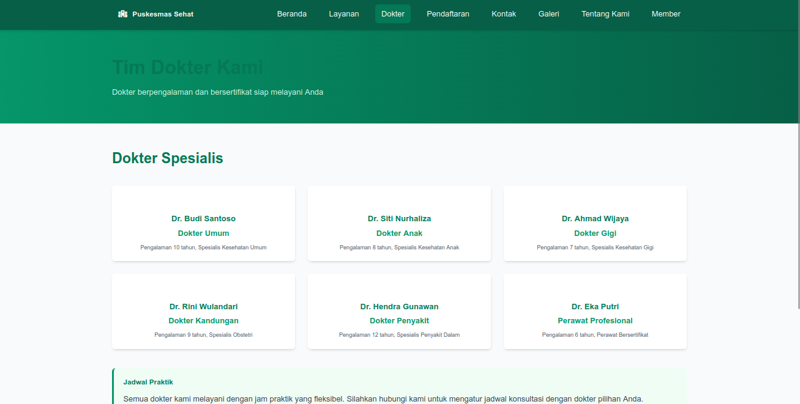
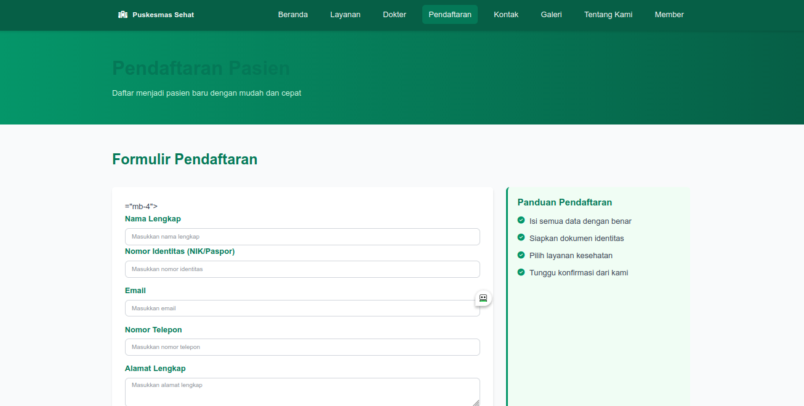
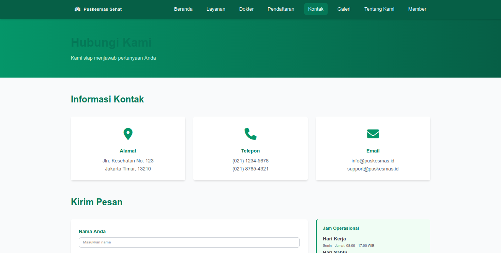
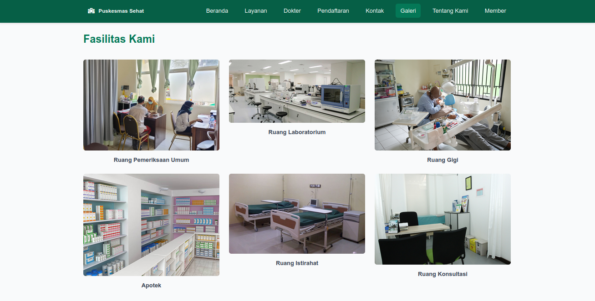
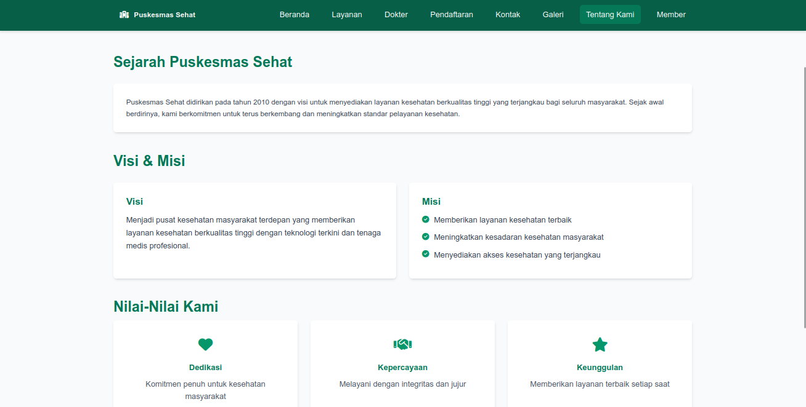
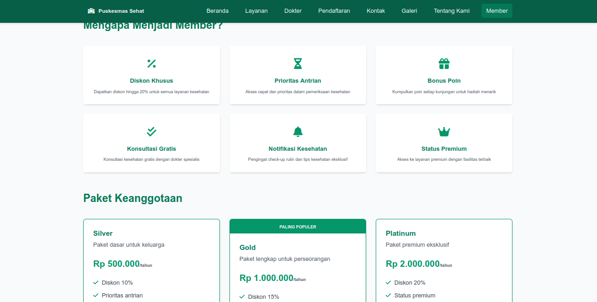

# Tugas Pemrograman Web - Puskesmas Purwokerto

BAB 3 - CSS

## Identitas Mahasiswa
- Nama: Davis Arvaputra Dwiansyah
- NIM: 103122400034
- Kelas: SE-08-01

## Deskripsi Penerapan CSS
1. **External Stylesheet (`styles/style.css`)**: Seluruh halaman terhubung dengan satu file stylesheet terpusat di folder `styles/`.
2. **Font Properties**: Menggunakan font modern `Segoe UI`, `Roboto`, `Arial` dengan standarisasi `font-size` dan `font-weight`.
3. **Styling List**: Menata navigasi bar horizontal tanpa bullet, serta list teratur pada bagian konten.
4. **Text Alignment**: Pengaturan perataan teks (`text-center` pada header/footer, `text-left` pada artikel/tabel).
5. **Identitas Warna**: Palet warna konsisten bertema fasilitas kesehatan (Emerald Green `#065f46`, Mint `#10b981`, dan Latar `#f9fafb`).
6. **Pengelompokan Div & Span**: Penggunaan `.container`, `.card`, `.rounded-lg`, `.shadow-md`, dan pembagian grid untuk tata letak dan penandaan khusus.
7. **Desain Responsif (@media query)**: Penerapan breakpoint `@media (max-width: 768px)` di mana navigasi horizontal berubah secara dinamis menjadi navigasi vertikal pada layar mobile.

## Hasil Screenshot

### 1. Tampilan Desktop (Navigasi Horizontal)

### 2. Tampilan Mobile (Navigasi Vertikal via @media query)

### 3. Screenshot Halaman Lainnya
- **Beranda (index.html)**: 
- **Layanan (layanan.html)**: 
- **Dokter (dokter.html)**: 
- **Pendaftaran (pendaftaran.html)**: 
- **Kontak (kontak.html)**: 
- **Galeri (galeri.html)**: 
- **Tentang Kami (tentang-kami.html)**: 
- **Member (member.html)**: 
