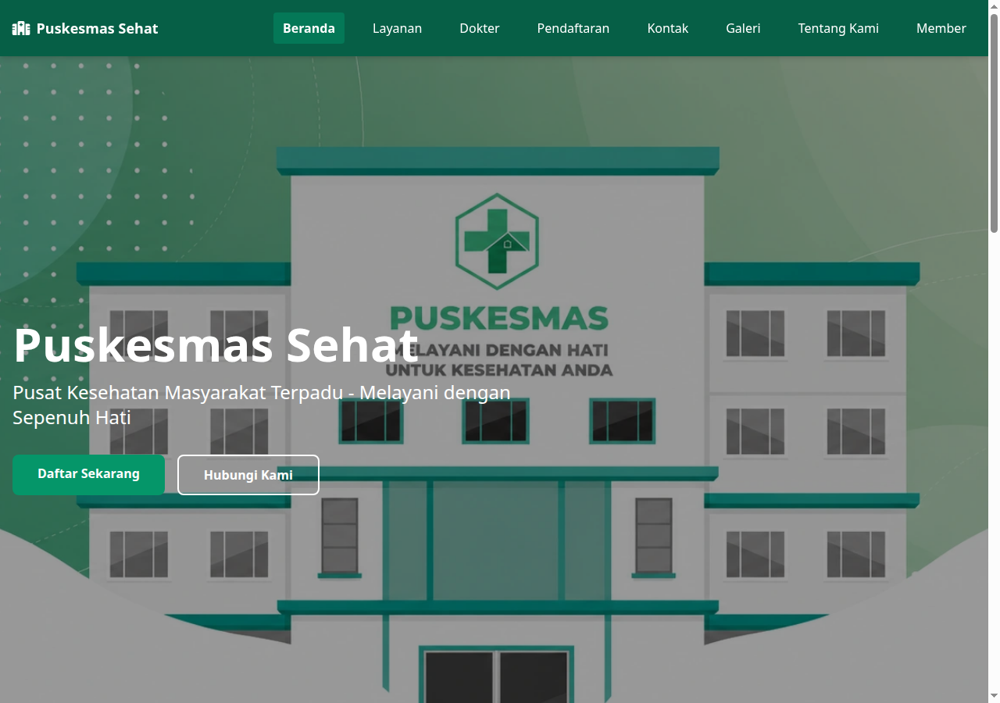
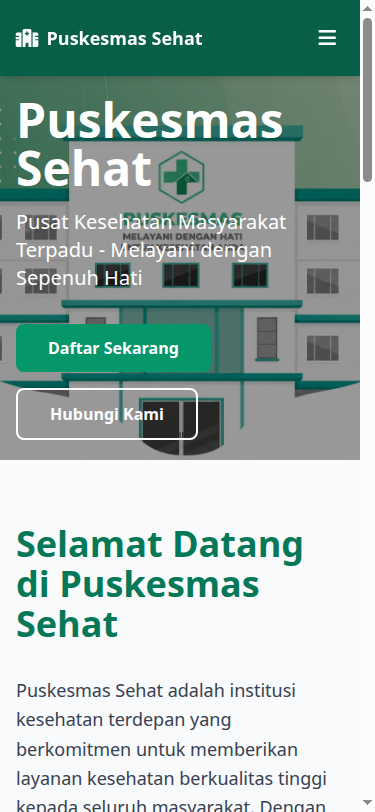
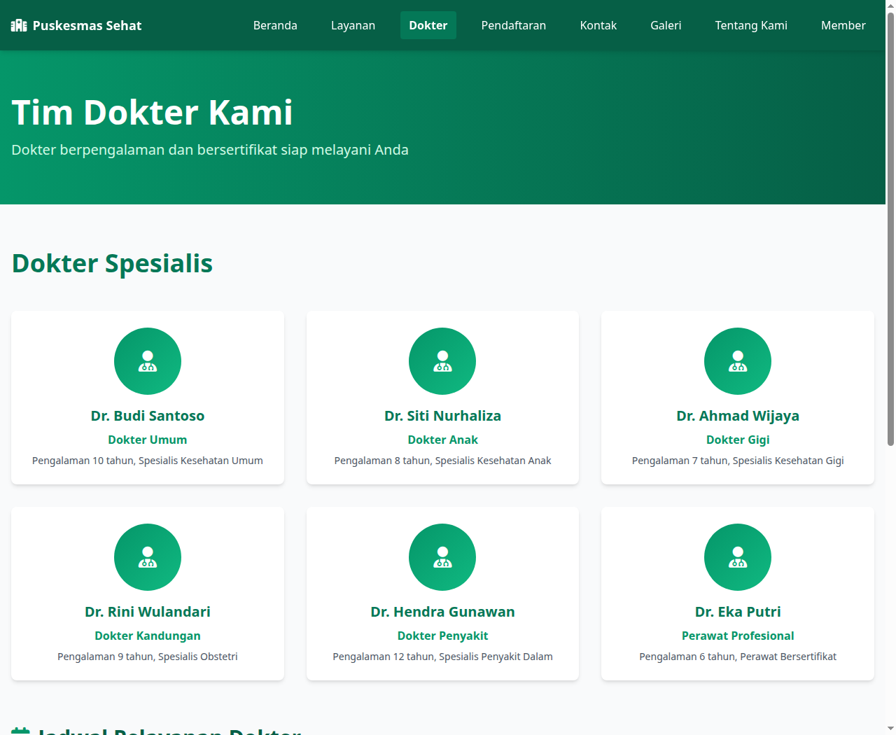
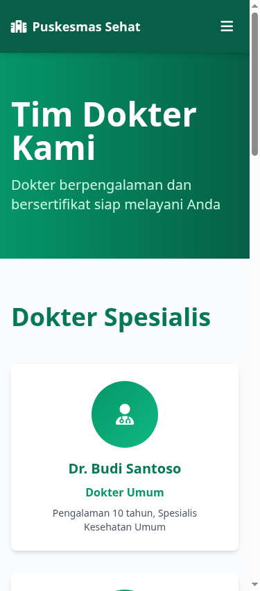
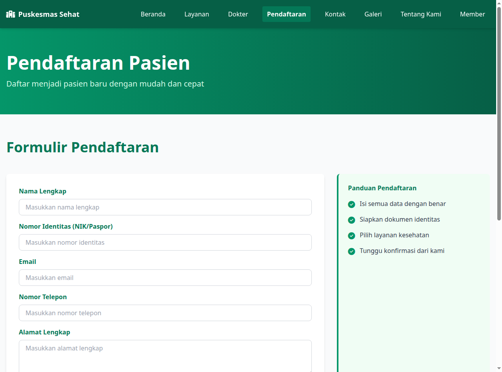
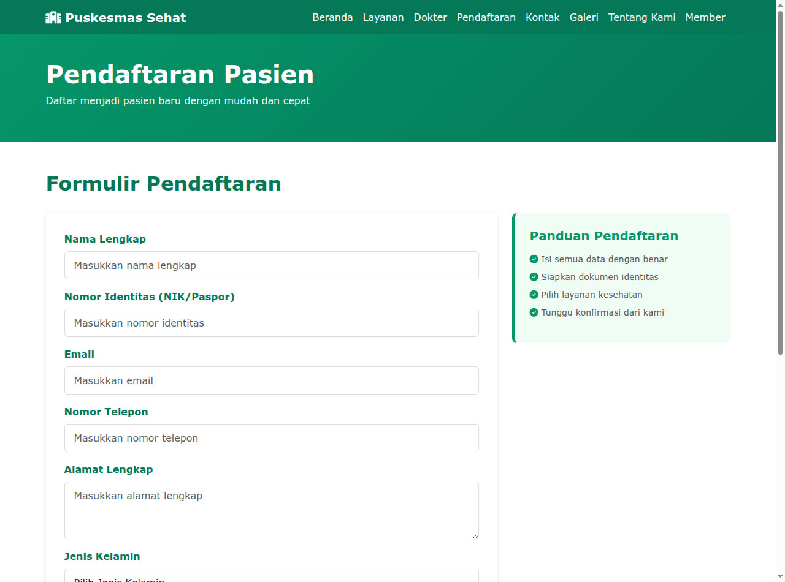
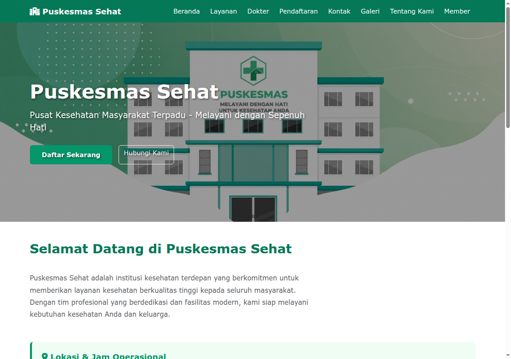
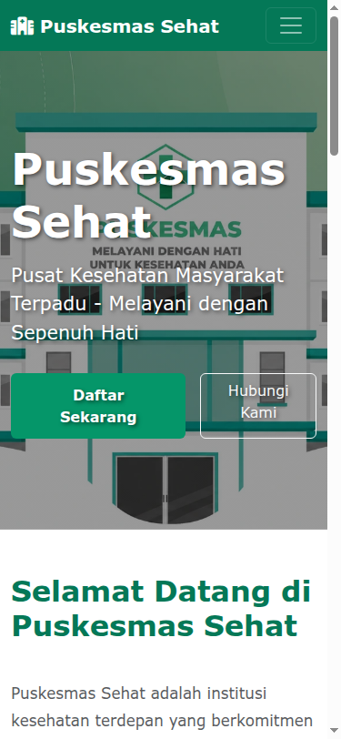

# Tugas 04 - Pemrograman Web: Implementasi CSS Framework (Bootstrap vs Tailwind)

## Identitas Mahasiswa
- **Nama**: Davis Arvaputra Dwiansyah
- **NIM**: 103122400034
- **Kelas**: SE-08-01
- **Program Studi**: S1 Rekayasa Perangkat Lunak
- **Mata Kuliah**: Perancangan dan Pemrograman Web

---

## 1. Studi Kasus Aplikasi
**Judul Kasus**: *Puskesmas Sehat - Sistem Layanan dan Informasi Fasilitas Kesehatan Masyarakat Terpadu (Puskesmas Purwokerto)*

Aplikasi ini dirancang sebagai platform portal web layanan kesehatan tingkat pertama yang melayani kebutuhan masyarakat umum. Sistem ini menyediakan:
1. Informasi layanan medis poliklinik dan fasilitas rawat jalan/inap.
2. Jadwal praktik dokter spesialis dan umum secara transparan dan mudah dibaca.
3. Formulir pendaftaran pasien baru secara mandiri tanpa harus mengantre lama di loket fisik.
4. Program keanggotaan/member kesehatan untuk akses prioritas dan pemeriksaan berkala.
5. Saluran kontak darurat dan informasi jam operasional puskesmas.

---

## 2. Pemenuhan Kerangka Halaman Minimal

Sesuai instruksi penugasan, proyek ini telah mengimplementasikan kerangka halaman lengkap pada dua versi framework:
- Folder [`bootstrap-version/`](bootstrap-version/) menggunakan **Bootstrap 5.3 CDN**
- Folder [`tailwind-version/`](tailwind-version/) menggunakan **Tailwind CSS CDN**

### A. Halaman Utama / Dashboard (`index.html`)
- Menggunakan layout grid modern:
  - **Bootstrap**: Sistem 12-kolom `.container`, `.row`, `.col-lg-*`, `.col-md-*`.
  - **Tailwind**: Utility grid & flexbox (`container mx-auto`, `grid grid-cols-1 md:grid-cols-3 gap-8`, `flex flex-wrap`).
- Memuat hero banner selamat datang, kartu ringkasan layanan unggulan, nilai keunggulan fasilitas, dan tombol aksi (Call-to-Action) pendaftaran.

### B. Halaman Tabel Data (`dokter.html`)
- Menyajikan **Tabel Jadwal Pelayanan Dokter** dengan format tabular terstruktur:
  - Kolom: *Nama Dokter, Poli/Unit, Hari Pelayanan, Waktu Praktik, Ruang Praktik*.
  - **Bootstrap**: Dilengkapi kelas `.table`, `.table-hover`, `.table-striped`, `.table-bordered`, dan `.table-responsive` untuk scroll horizontal di mobile.
  - **Tailwind**: Menggunakan pembungkus `overflow-x-auto`, border divide `divide-y divide-gray-200`, dan badge warna penanda poliklinik.
- Dilengkapi kartu profil tim dokter spesialis dengan avatar dan keahlian masing-masing.

### C. Halaman Formulir (`pendaftaran.html` & `member.html`)
- **Pendaftaran Pasien (`pendaftaran.html`)**: Formulir registrasi pasien baru dengan input nama lengkap, NIK/identitas, email, nomor telepon, alamat, jenis kelamin, tanggal lahir, dan pilihan poli rujukan.
- **Program Member (`member.html`)**: Formulir pendaftaran paket keanggotaan kesehatan keluarga.
- Seluruh input form telah diatur dengan kontrol responsif, label terstruktur, serta fokus indikator yang ramah pengguna.

### D. Navigasi Responsif
- **Desktop (≥ 992px / 1024px)**: Menu navigasi tampil horizontal lengkap dengan 8 tautan halaman (*Beranda, Layanan, Dokter, Pendaftaran, Kontak, Galeri, Tentang Kami, Member*).
- **Mobile (≤ 768px)**: Header menyusut rapi satu baris dengan tombol hamburger toggler yang memunculkan menu dropdown secara dinamis tanpa merusak tata letak.

---

## 3. Alasan Pemilihan Framework untuk Proyek Akhir

### Analisis Komparatif:

| Parameter | Bootstrap 5 | Tailwind CSS |
|---|---|---|
| **Paradigma** | *Component-based* (komponen jadi siap pakai) | *Utility-first* (kelas utilitas modular rendah) |
| **Kecepatan Prototipe** | Sangat cepat untuk komponen standar (modal, navbar, card) | Cepat setelah terbiasa dengan nama kelas utilitas |
| **Kustomisasi & Branding** | Memerlukan override CSS kustom untuk mengubah gaya bawaan | Fleksibilitas 100% tanpa batasan gaya bawaan |
| **Ukuran & Performa** | Bundle CSS/JS monolitik (memuat semua fitur bawaan) | Sangat optimal pada produksi berkat eliminasi CSS yang tidak terpakai (PurgeCSS) |
| **Desain Responsif** | Menggunakan breakpoint standar (`col-sm`, `col-md`, `col-lg`) | Menggunakan prefiks responsif intuitif (`sm:`, `md:`, `lg:`, `xl:`) langsung pada elemen |

### Keputusan Pemilihan:
Untuk kelanjutan proyek akhir semester **Puskesmas Purwokerto**, framework yang dipilih adalah **Tailwind CSS**, dengan pertimbangan:
1. **Identitas Visual Kesehatan yang Unik**: Karakteristik aplikasi puskesmas membutuhkan identitas warna khusus (*Emerald Health Green* `#047857` dan `#059669`) serta nuansa kartu modern yang bersih dan ramah pasien. Tailwind memungkinkan penyesuaian visual presisi tanpa harus bertarung dengan gaya bawaan (*CSS specificity conflict*).
2. **Efisiensi Performa di Perangkat Mobile Pasien**: Sebagian besar masyarakat mengakses layanan kesehatan dan pendaftaran melalui smartphone dengan berbagai kualitas koneksi internet. Tailwind menghasilkan output CSS yang sangat ringkas sehingga waktu pemuatan halaman (*page load time*) menjadi lebih cepat.
3. **Kemudahan Integrasi Modern Stack**: Fleksibilitas utilitas Tailwind mempermudah transisi proyek saat dihubungkan dengan kerangka kerja backend dinamis (seperti Laravel Blade atau modern JavaScript framework) di tahap semester berikutnya.

---

## 4. Hasil Pengujian Tampilan Responsif (Screenshots)

### 1. Tampilan Halaman Utama / Dashboard
| Tampilan Desktop (≥ 1024px) | Tampilan Mobile (≤ 768px) |
|:---:|:---:|
|  |  |

### 2. Tampilan Halaman Tabel Data (Jadwal Pelayanan Dokter)
| Tampilan Desktop (≥ 1024px) | Tampilan Mobile (≤ 768px) |
|:---:|:---:|
|  |  |

### 3. Tampilan Halaman Formulir Pendaftaran Pasien
| Formulir Desktop (Tailwind Version) | Formulir Desktop (Bootstrap Version) |
|:---:|:---:|
|  |  |

### 4. Tampilan Versi Bootstrap 5
| Dashboard Desktop (Bootstrap) | Dashboard Mobile (Bootstrap) |
|:---:|:---:|
|  |  |
