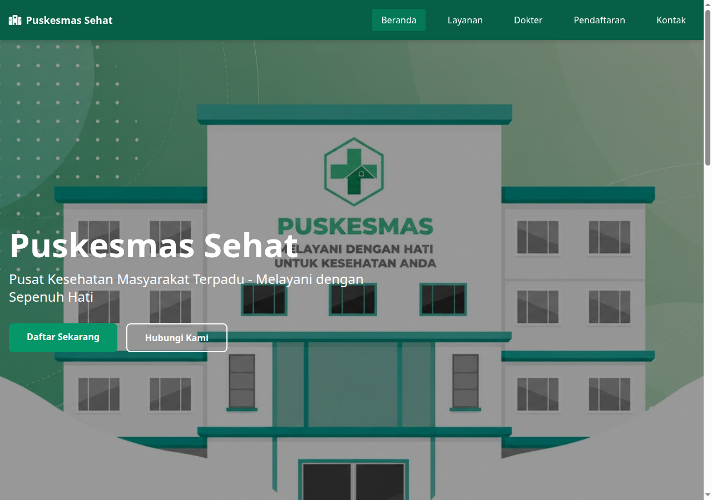
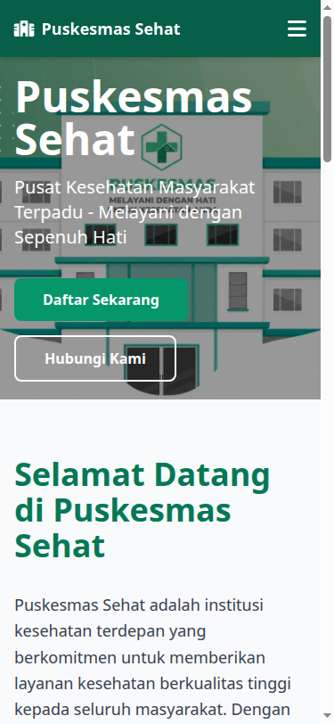
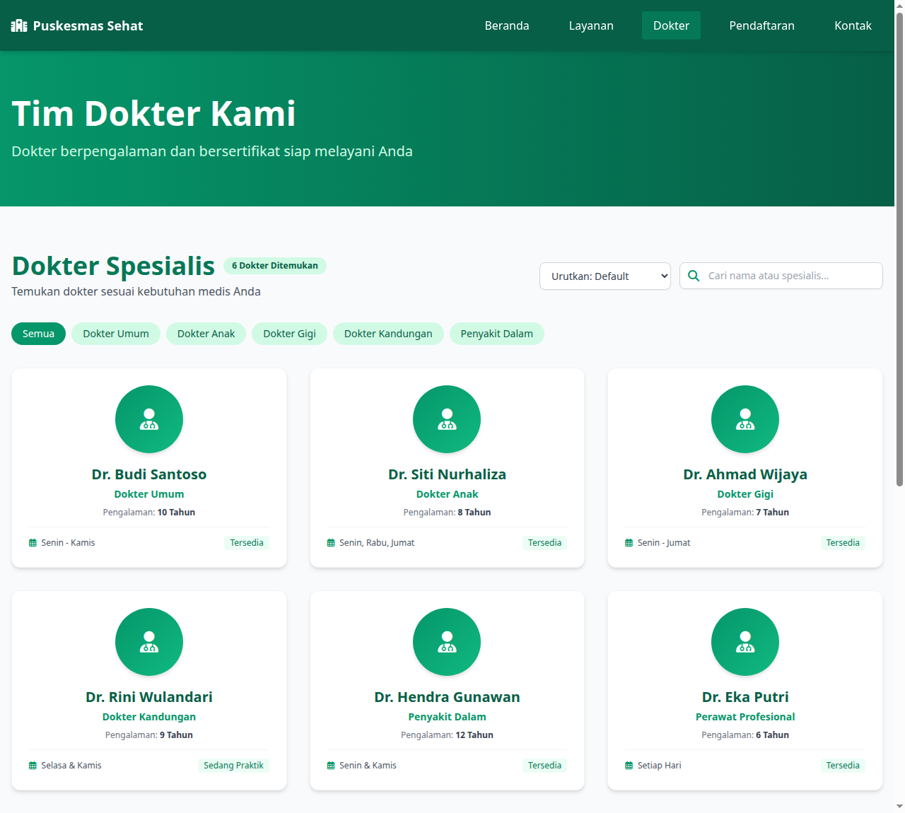
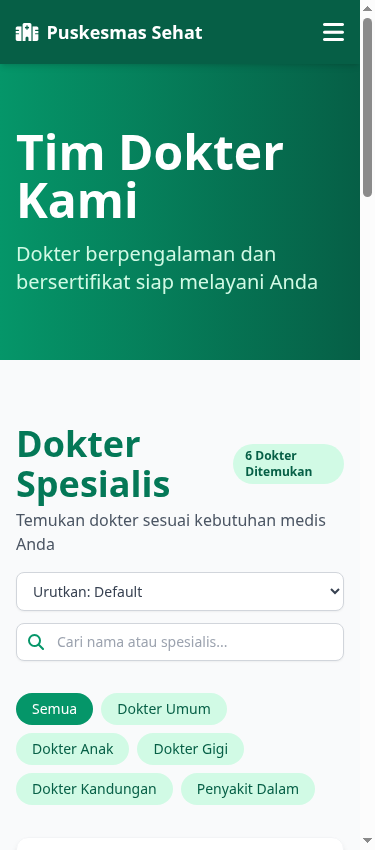
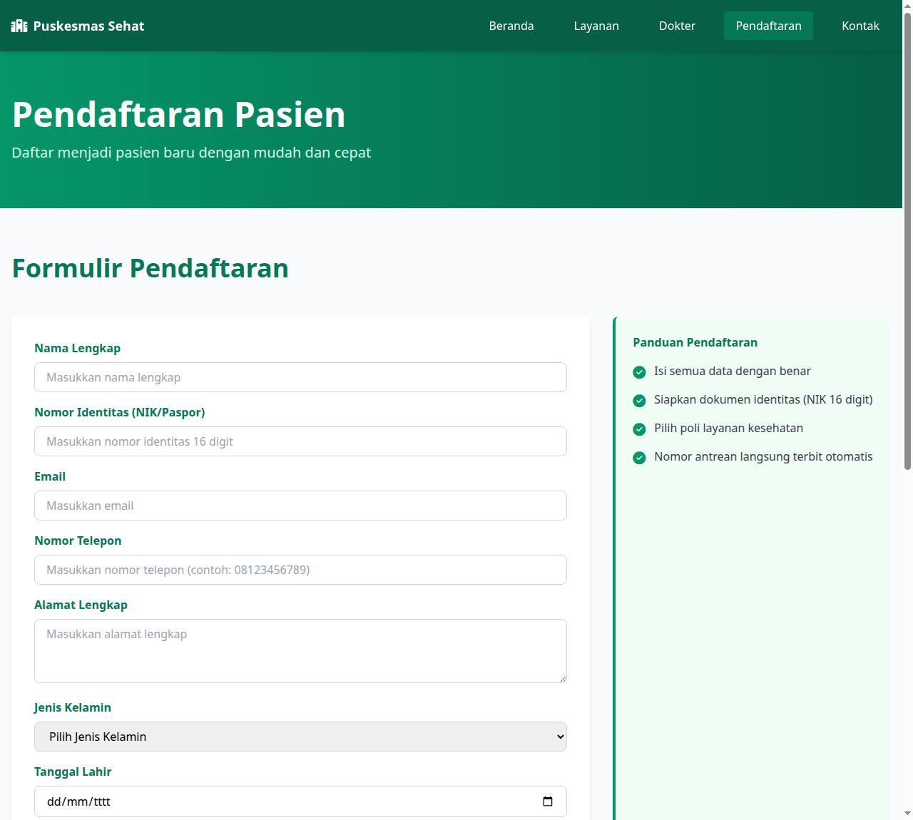
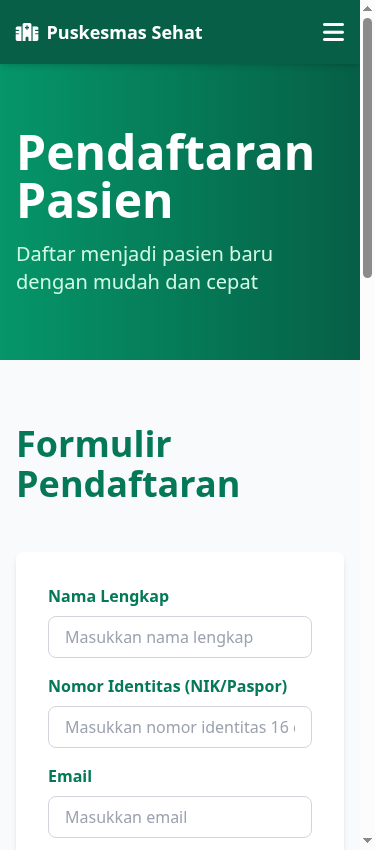

# Tugas 05 - Pemrograman Web: Interaktivitas Client-Side (JavaScript & jQuery)

## Identitas Mahasiswa
- **Nama**: Davis Arvaputra Dwiansyah
- **NIM**: 103122400034
- **Kelas**: SE-08-01
- **Program Studi**: S1 Rekayasa Perangkat Lunak
- **Mata Kuliah**: Perancangan dan Pemrograman Web

---

## 1. Studi Kasus Aplikasi
**Judul**: *Puskesmas Sehat - Sistem Layanan Pasien dan Manajemen Antrean Terpadu (Puskesmas Purwokerto)*

Aplikasi portal web pelayanan kesehatan masyarakat tingkat pertama yang mengintegrasikan pencarian dokter spesialis, jadwal pelayanan medis, pendaftaran pasien baru secara mandiri, dan monitoring antrean harian secara langsung (*live queue*) di sisi client.

---

## 2. Implementasi JavaScript Murni (Vanilla JS)

Sesuai kriteria instruksi penugasan, seluruh data utama dan logika pemrosesan dibangun menggunakan Vanilla JavaScript murni:

### A. Variabel & Tipe Data Dasar (Array of Objects)
Terdapat dua struktur data master berbasis *Array of Objects* di [js/script.js](js/script.js):
1. **`daftarDokter`**: Menyimpan data master dokter spesialis:
   - Properti: `id`, `nama`, `spesialis`, `kategori`, `pengalaman` (tahun), `hari`, `jam`, `ruang`, `status`, dan `badgeColor`.
2. **`antreanPasien`**: Menyimpan data live antrean pendaftaran pasien harian:
   - Properti: `id`, `noAntrean` (misal `A-001`, `B-002`), `nama`, `nik`, `layanan`, `jamDaftar`, dan `status`.

### B. Fungsi-Fungsi Pemrosesan Data
1. **`hitungTotalDokter(data)`**: Menghitung jumlah dokter yang sesuai dengan filter pencarian aktif.
2. **`hitungAntreanAktif()`**: Menghitung total pasien dalam antrean yang belum selesai diperiksa.
3. **`filterDokterData(kategori, keyword)`**: Memproses filter data berdasarkan kategori poliklinik dan pencarian teks nama/spesialisasi.
4. **`sortDokterData(data, sortKey)`**: Mengurutkan array dokter berdasarkan kriteria: abjad nama (A-Z / Z-A) atau masa pengalaman terlama.
5. **`tambahPasienBaru(dataForm)`**: Menghasilkan nomor antrean otomatis dengan prefiks sesuai poli (A: Umum, B: Imunisasi, C: Gigi, D: Laboratorium) dan menambahkan objek pasien baru ke dalam array `antreanPasien`.
6. **`hapusPasienById(id)`**: Mencari indeks dan menghapus elemen pasien dari array `antreanPasien` menggunakan `splice()`.

### C. Struktur Kendali & Dynamic DOM Rendering
- **Perulangan (`forEach`)**:
  - `renderDokterCards(data)`: Melakukan iterasi pada array dokter dan merender template literal kartu profil dokter ke `#daftarDokter`.
  - `renderJadwalTable(data)`: Melakukan iterasi untuk menghasilkan baris tabel jadwal pelayanan dokter pada `#tbodyJadwalDokter`.
  - `renderTabelAntrean()`: Melakukan iterasi pada array antrean pasien untuk merender tabel antrean live pada `#tbodyAntreanPasien`.
- **Percabangan (`if/else`)**:
  - Pengecekan kondisi data kosong (`data.length === 0`) untuk memunculkan pesan peringatan kosong secara elegan.
  - Penentuan warna badge status ketersediaan dokter (*Tersedia* vs *Sedang Praktik*).
  - Pengecekan status antrean pasien (*Menunggu* vs *Dipanggil*).

---

## 3. Implementasi jQuery

Interaktivitas visual, event handling, dan animasi diimplementasikan secara terintegrasi menggunakan **jQuery 3.7.1**:

### A. Event Handling
1. **`$("#formPendaftaran").on("submit", ...)`**:
   - Mencegah reload halaman default (`e.preventDefault()`).
   - Melakukan validasi input: memeriksa field kosong, format NIK (harus 16 digit angka regex `/^[0-9]{16}$/`), dan nomor telepon (minimal 10 digit).
   - Menambahkan data dummy baru ke tabel antrean secara dinamis.
2. **`$(document).on("click", ".btn-hapus-antrean", ...)`**:
   - Event delegasi untuk tombol hapus/batalkan antrean dummy pada tiap baris tabel.
3. **`$("#cariDokter").on("keyup", ...)` & `$(".filter-dokter-btn").on("click", ...)`**:
   - Pencarian real-time dan filter kategori instan tanpa perlu reload.
4. **`$("#sortDokter").on("change", ...)`**:
   - Mengubah urutan tampilan kartu dokter dan tabel jadwal saat opsi dropdown diganti.
5. **`$(".kartu-galeri").on("click", ...)`**:
   - Membuka modal preview informasi fasilitas kesehatan.

### B. Efek & Animasi Antarmuka
1. **`slideToggle(200)`**: Menampilkan dan menyembunyikan menu navigasi dropdown mobile.
2. **`fadeIn(200)` / `fadeOut(200)`**:
   - Transisi halus untuk universal modal dialog alert (`#universalModal`) dengan backdrop blur.
   - Efek kemunculan tombol floating *Back-to-Top* saat halaman di-scroll melewati 300px.
3. **`fadeOut(350)`**: Animasi baris tabel antrean pasien yang memudar perlahan sebelum dihapus dari tampilan saat aksi hapus dijalankan.
4. **`animate({ scrollTop: ... }, 400)`**: Efek *smooth scroll* saat kembali ke atas halaman atau otomatis mengarahkan fokus ke tabel antrean setelah pendaftaran berhasil.

---

## 4. Hasil Pengujian Tampilan Responsif & Interaksi (Screenshots)

### 1. Halaman Utama / Beranda (Interaktivitas Menu Mobile)
| Tampilan Desktop (≥ 1024px) | Tampilan Mobile (≤ 768px) |
|:---:|:---:|
|  |  |

### 2. Halaman Dokter (Dynamic Cards & Dynamic Schedule Table)
| Tampilan Desktop (≥ 1024px) | Tampilan Mobile (≤ 768px) |
|:---:|:---:|
|  |  |

### 3. Halaman Pendaftaran (Formulir & Live Queue Table)
| Tampilan Desktop (≥ 1024px) | Tampilan Mobile (≤ 768px) |
|:---:|:---:|
|  |  |
